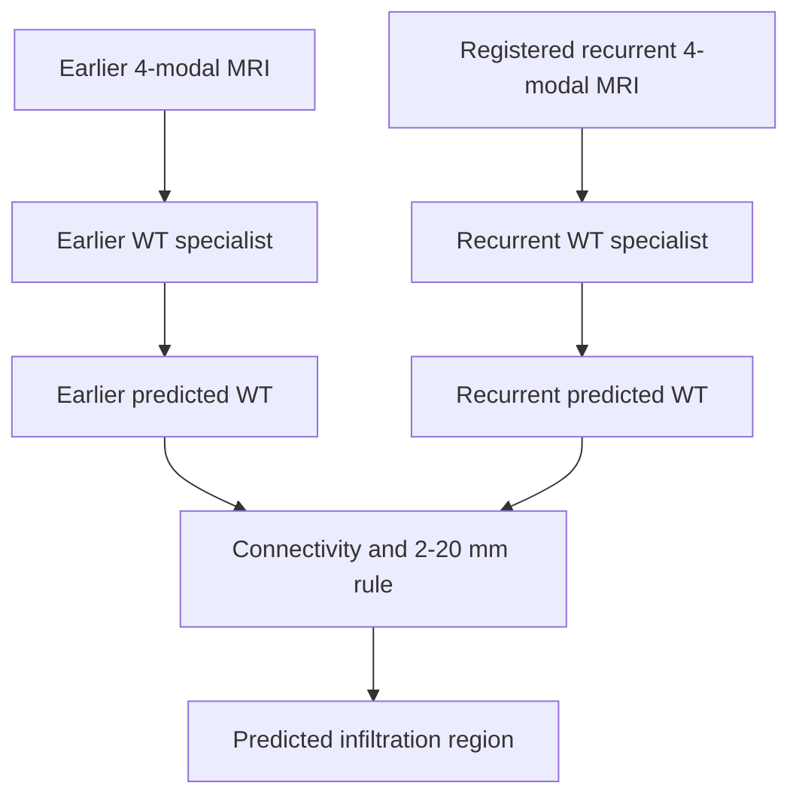
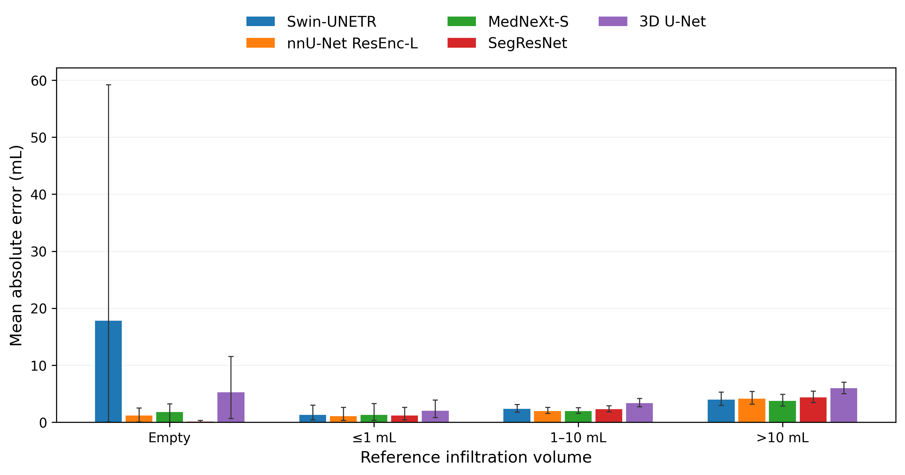
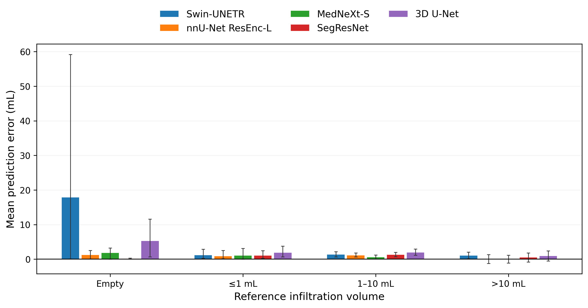

# Longitudinal Glioma Infiltration Mapping

An end-to-end research pipeline for estimating spatial glioma infiltration from longitudinal, multimodal brain MRI. The project registers a recurrent scan to an earlier scan, constructs a distance- and connectivity-constrained infiltration target, trains timepoint-specific whole-tumor segmentation specialists, and derives the predicted infiltration region from their outputs.

This repository contains the public research code, aggregate five-fold cross-validation results, statistical analyses, and publication figures. It does **not** contain medical images, case-level records, private manifests, pretrained or finetuned weights, predictions, or rendered QC images.

> **Research-use notice:** This code is provided for transparent scientific inspection and reproducibility. It is not a medical device and is not intended for clinical diagnosis, treatment planning, or patient-level decision-making.

## Contents

- [Research objective](#research-objective)
- [Study data](#study-data)
- [Method](#method)
- [Experimental design](#experimental-design)
- [Results](#results)
- [Repository map](#repository-map)
- [Installation and configuration](#installation-and-configuration)
- [Running the pipeline](#running-the-pipeline)
- [Monitoring and resuming HPC experiments](#monitoring-and-resuming-hpc-experiments)
- [Data, weights, privacy, and licensing](#data-weights-privacy-and-licensing)

## Research objective

The task is to identify recurrent tumor tissue that extends locally beyond the earlier whole-tumor boundary. Rather than asking one network to predict the infiltration label directly, the final framework separates the problem into three interpretable stages:

1. segment whole tumor independently at the earlier and recurrent timepoints;
2. align the recurrent prediction to the earlier image space; and
3. apply the same deterministic spatial rule used to construct the reference infiltration label.



This decomposition makes the final output traceable to two segmentation masks and an explicit anatomical rule.

## Study data

### Datasets used in the reported experiments

| Role | Dataset | Use in this project | Included here? |
|---|---|---|---|
| Longitudinal target generation and finetuning | MU-Glioma-Post | Consecutive earlier/recurrent MRI pairs, four MRI modalities, and tumor masks | No; access-controlled data remain external |
| Model initialization | Audited four-modality BraTS-derived checkpoints | Initialization for the five architectures before MU-Glioma-Post finetuning | No; checkpoint files and source pretraining data remain external |

The final reported experiments use **MU-Glioma-Post only** for task-specific training, validation, and testing. Other exploratory datasets are not part of the result tables in this release.

### Cohort construction

The exact label-generation workflow processes **391 consecutive scan pairs from 155 patients**. Registration and label outputs are audited before modeling. A fixed set of 38 registration-QC review-required pairs is excluded from model development without manually changing any label. The final modeling cohort therefore contains **353 scan pairs from 146 patients**.

Each scan contributes four MRI sequences:

- T1-weighted (`t1n` / T1)
- contrast-enhanced T1-weighted (`t1c` / T1CE)
- T2-weighted (`t2w` / T2)
- T2-FLAIR (`t2f` / FLAIR)

The private pairing manifest is not published. Its required schema is documented with synthetic values in [`src/label_generation/manifests/manifest.example.csv`](src/label_generation/manifests/manifest.example.csv).

## Method

### 1. Longitudinal registration

For each consecutive pair, the recurrent T1 image is rigidly registered to the earlier T1 image with ANTs. Tumor and cavity labels are dilated by 10 mm and excluded from the registration masks so that lesion change does not drive the alignment. The saved rigid transform is then applied to:

- recurrent T1, T1CE, T2, and FLAIR using linear interpolation; and
- the recurrent segmentation using label-preserving `genericLabel` interpolation.

The implementation is in [`generate_mu_case_exact_v2.py`](src/label_generation/generate_mu_case_exact_v2.py).

### 2. Reference infiltration-label construction

Whole tumor is defined from segmentation labels 1, 2, and 3. If the earlier scan has no visible labels 1–3 but contains resection-cavity label 4, the cavity is used as the earlier reference.

Let \(E\) be the earlier reference mask, \(R\) the registered recurrent whole-tumor mask, and \(d_E(x)\) the physical Euclidean distance in millimeters from voxel \(x\) to \(E\). Each 26-connected component of \(R\) is retained only if its minimum distance to \(E\) is at most 2 mm. The reference infiltration target is

$$
I = R_{\mathrm{anchored}} \cap \{x : 2 < d_E(x) \leq 20\ \mathrm{mm}\}.
$$

Disconnected recurrent components and connected recurrence farther than 20 mm are stored as excluded regions rather than positive infiltration. The workflow also saves transforms, registered modalities, registered segmentations, per-case metrics, QC panels, and cryptographic hashes in the protected HPC workspace. These patient-level outputs are not part of this public repository.

### 3. Two-specialist prediction framework

Every architecture is instantiated twice:

- an **earlier specialist** receives the earlier four-modal MRI and predicts earlier whole tumor; and
- a **recurrent specialist** receives the registered recurrent four-modal MRI and predicts recurrent whole tumor.

The two specialists are optimized with equal timepoint weighting. Their predicted masks are passed through the same connected-component and 2–20 mm distance rule used for the reference label. Checkpoint-compatible WT/TC/ET heads are retained where required by the pretrained architecture, but the reported finetuning objective and downstream rule use the whole-tumor channel.

### 4. Architectures

| Model | Implementation | Patch size | Key configuration |
|---|---|---:|---|
| 3D U-Net | MONAI `UNet` | 128 × 128 × 128 | Channels 32, 64, 128, 256, 320 |
| SegResNet | MONAI `SegResNet` | 128 × 128 × 128 | 32 initial filters |
| MedNeXt-S | Local MedNeXt-v1 implementation | 128 × 128 × 128 | Small variant, kernel size 3 |
| Swin-UNETR | MONAI `SwinUNETR` | 96 × 96 × 96 | Feature size 48, checkpointing enabled |
| nnU-Net ResEnc-L | nnU-Net v2.8.1 residual encoder U-Net | 160 × 192 × 160 | Reconstructed from locked ResEnc-L plans |

## Experimental design

### Patient-grouped five-fold cross-validation

All models use the same immutable, patient-grouped outer folds. No patient appears in more than one outer test fold, and every eligible pair is evaluated exactly once. Training and inner-validation partitions are also patient disjoint; inner validation is used for checkpoint selection, while the held-out outer test partition is used once for final evaluation.

| Outer fold | Test pairs | Test patients |
|---:|---:|---:|
| 0 | 73 | 30 |
| 1 | 70 | 29 |
| 2 | 71 | 29 |
| 3 | 70 | 29 |
| 4 | 69 | 29 |
| **Total** | **353** | **146** |

### Common training protocol

- initialization from each architecture's audited BraTS-derived checkpoint;
- maximum 30 epochs and 480 sampled pairs per epoch;
- equal loss weighting between earlier and recurrent specialists;
- per-specialist loss: 0.70 soft Dice + 0.30 BCE-with-logits;
- AdamW optimization with cosine annealing;
- BF16 mixed precision when supported, otherwise FP32;
- effective pair batch size 8, with automatic microbatch probing and gradient accumulation where required;
- minimum 8 epochs and early-stopping patience of 6 epochs; and
- checkpoint selection from pretrained epoch 0 and finetuned epochs using inner-validation performance only.

The scheduler runs two folds concurrently, one fold per GPU. It writes periodic checkpoints, maintains per-stage logs, survives terminal disconnection, and resumes incomplete folds from the latest compatible checkpoint.

### Evaluation

Reported segmentation metrics include earlier WT Dice, recurrent WT Dice, and their mean. Infiltration evaluation includes voxel Dice, IoU, precision, recall, AUPRC, lesion F1, HD95, ASSD, 1-mm surface Dice, empty-case accuracy, and volume-stratified performance. Confidence intervals use 2,000 patient-level bootstrap repetitions. Volume agreement is summarized with Spearman correlation, Lin's concordance correlation coefficient (CCC), absolute error, bias, and Bland–Altman limits of agreement.

## Results

All numbers below are read directly from the files under [`results/`](results/). Pooled metrics use all 353 outer-fold predictions. Infiltration overlap metrics are evaluated on the 346 nonempty reference cases; empty accuracy is based on the remaining 7 cases.

### Pooled out-of-fold segmentation and infiltration performance

| Model | Earlier WT Dice | Recurrent WT Dice | Mean seg. Dice | Infiltration Dice | AUPRC | Precision | Recall |
|---|---:|---:|---:|---:|---:|---:|---:|
| 3D U-Net | 0.785 | 0.803 | 0.794 | 0.479 | 0.367 | 0.487 | 0.537 |
| SegResNet | 0.849 | 0.848 | 0.848 | 0.575 | 0.488 | 0.582 | 0.625 |
| MedNeXt-S | 0.866 | 0.858 | 0.862 | 0.603 | 0.523 | **0.624** | 0.637 |
| Swin-UNETR | **0.868** | 0.856 | 0.862 | **0.608** | **0.531** | 0.608 | **0.662** |
| nnU-Net ResEnc-L | 0.864 | **0.860** | **0.862** | 0.605 | 0.510 | 0.613 | 0.649 |

The unrounded mean segmentation Dice values for Swin-UNETR and nnU-Net ResEnc-L are 0.862266 and 0.862493, respectively.

### Lesion and surface performance

| Model | Lesion F1 | HD95 (mm) ↓ | ASSD (mm) ↓ | Surface Dice at 1 mm ↑ | Empty accuracy* |
|---|---:|---:|---:|---:|---:|
| 3D U-Net | 0.343 | 17.858 | 5.955 | 0.551 | 0.143 |
| SegResNet | 0.482 | 12.243 | 3.698 | 0.676 | 0.571 |
| MedNeXt-S | 0.497 | 9.416 | 3.090 | **0.716** | **0.714** |
| Swin-UNETR | **0.506** | 13.057 | 3.743 | 0.707 | 0.286 |
| nnU-Net ResEnc-L | 0.489 | **8.811** | **2.817** | 0.712 | 0.571 |

\*Empty accuracy is based on only seven empty-reference cases and should be interpreted cautiously. HD95, ASSD, and surface Dice are reported for detected nonempty cases as defined by the evaluation code.

### Patient-bootstrap 95% confidence intervals

| Model | Mean seg. Dice (95% CI) | Infiltration Dice (95% CI) | Infiltration AUPRC (95% CI) |
|---|---:|---:|---:|
| 3D U-Net | 0.794 (0.767–0.818) | 0.479 (0.440–0.515) | 0.367 (0.328–0.404) |
| SegResNet | 0.848 (0.826–0.869) | 0.575 (0.536–0.613) | 0.488 (0.445–0.530) |
| MedNeXt-S | 0.862 (0.838–0.884) | 0.603 (0.562–0.642) | 0.523 (0.479–0.565) |
| Swin-UNETR | 0.862 (0.840–0.883) | 0.608 (0.568–0.647) | 0.531 (0.488–0.573) |
| nnU-Net ResEnc-L | 0.862 (0.839–0.884) | 0.605 (0.566–0.644) | 0.510 (0.467–0.553) |

### Infiltration Dice by reference volume

| Model | ≤0.1 mL (n=6) | 0.1–1 mL (n=48) | 1–10 mL (n=153) | >10 mL (n=139) |
|---|---:|---:|---:|---:|
| 3D U-Net | 0.021 | 0.161 | 0.387 | 0.709 |
| SegResNet | 0.047 | 0.229 | 0.516 | 0.783 |
| MedNeXt-S | 0.065 | **0.278** | 0.544 | 0.803 |
| Swin-UNETR | **0.076** | 0.257 | **0.558** | **0.807** |
| nnU-Net ResEnc-L | 0.062 | 0.273 | 0.557 | 0.796 |

Performance increases substantially with infiltration volume, emphasizing the difficulty of detecting very small expansion regions.

### Infiltration-volume agreement

| Model | Spearman ρ | Lin CCC | MAE (mL) ↓ | Median AE (mL) ↓ | Bias (mL) | 95% limits of agreement (mL) |
|---|---:|---:|---:|---:|---:|---:|
| Swin-UNETR | 0.913 | 0.940 | 3.175 | 1.193 | 1.562 | −15.052 to 18.176 |
| nnU-Net ResEnc-L | 0.924 | **0.973** | 2.737 | 1.009 | 0.719 | −10.171 to 11.608 |
| MedNeXt-S | 0.914 | 0.973 | **2.593** | **0.993** | **0.498** | −10.608 to 11.604 |
| SegResNet | **0.929** | 0.972 | 2.943 | 1.197 | 0.947 | −10.128 to 12.023 |
| 3D U-Net | 0.872 | 0.956 | 4.273 | 2.425 | 1.651 | −11.946 to 15.247 |





## Repository map

```text
.
├── README.md
├── requirements.txt
├── .env.example
├── PUBLICATION_AUDIT.txt
├── src/
│   ├── label_generation/
│   ├── models/
│   │   ├── unet3d/
│   │   ├── segresnet/
│   │   ├── mednext_s/
│   │   ├── swin_unetr/
│   │   └── nnunet_resenc_l/
│   └── biomarker_analysis/
├── results/
│   ├── models/<model>/
│   └── biomarker/
└── qc/
    └── README.md
```

### Label-generation files

| File | Responsibility |
|---|---|
| `src/label_generation/path_config.py` | Resolves project, data, output, control, and manifest paths from environment variables |
| `generate_mu_case_exact_v2.py` | Registers one pair and creates the exact infiltration target and protected QC artifacts |
| `run_mu_exact_391_v2.py` | Executes all manifest pairs, records progress, and builds cohort summaries |
| `preflight_mu_exact_v2.py` | Verifies source data, manifest, geometry assumptions, and rule implementation before execution |
| `audit_mu_exact_outputs_v2.py` | Recomputes geometry/rule checks and verifies output integrity for all 391 pairs |
| `manager_mu_exact_v2.py` | Runs preflight, generation, and audit stages with resumable status tracking |
| `launch_mu_exact_v2.sh` | Starts the detached manager process |
| `monitor_mu_exact_v2.py` | Prints current stage, completed cases, and estimated progress |
| `stop_mu_exact_v2.sh` | Requests a safe, resumable stop |

### Model files

Every directory under `src/models/<model>/` follows the same operational layout:

| File | Responsibility |
|---|---|
| `common_v1.py` | Locked paths, architecture, data loading, transforms, metrics, inference, and deterministic infiltration rule |
| `train_v1.py` | Specialist training, validation, mixed precision, checkpointing, and resume logic |
| `evaluate_test_v1.py` | One-time held-out fold evaluation and protected case-level outputs |
| `aggregate_cv_v1.py` | Pooled OOF, fold, bootstrap, lesion/surface, and volume-bin summaries |
| `preflight_cv_v1.py` | Cohort, fold registry, checkpoint, architecture, and runtime validation |
| `fold_manager_v1.py` | Runs training and testing stages for one fold |
| `manager_v1.py` | Schedules two concurrent folds across two GPUs |
| `monitor_v1.py` | Cross-fold progress dashboard |
| `live_epoch_v1.py` | Detailed epoch-level progress for one fold |
| `launch_v1.sh` / `stop_v1.sh` | Detached launch and safe stop |
| `export_results_v1.sh` | Exports aggregate results without weights, predictions, or QC images |

MedNeXt-S additionally defines its architecture in `src/models/mednext_s/mednext_v1.py`.

### Analysis and public result files

| Path | Contents |
|---|---|
| `src/biomarker_analysis/run_analysis_v1.py` | Cross-model infiltration-volume analysis and figures |
| `src/biomarker_analysis/biomarker_common_v1.py` | Shared cohort locks, model registry, bootstrap settings, and statistics |
| `src/biomarker_analysis/preflight_v1.py` | Verifies identical OOF cohort/folds across models |
| `results/models/<model>/fold_metrics.csv` | Held-out metrics for each outer fold |
| `results/models/<model>/pooled_oof_summary.json` | Complete pooled metrics used in the tables above |
| `results/models/<model>/patient_bootstrap_95ci.csv` | Patient-bootstrap confidence intervals |
| `results/models/<model>/volume_bin_metrics.csv` | Performance stratified by reference infiltration volume |
| `results/models/<model>/macro_mean_sd_and_pooled.csv` | Fold mean, standard deviation, range, and pooled estimate |
| `results/biomarker/all_models_volume_agreement.csv` | Cross-model volume correlation, agreement, error, bias, and confidence intervals |
| `results/biomarker/all_models_bland_altman.csv` | Bland–Altman estimates and limits of agreement |
| `results/biomarker/*.png` / `*.pdf` | Publication-ready aggregate figures |

## Installation and configuration

Python 3.10 or newer is recommended. On the HPC, create or activate an isolated environment with a CUDA-compatible PyTorch build, then install the remaining dependencies:

```bash
git clone https://github.com/smAsifHossain/Longitudinal-Glioma-Infiltration-Mapping.git
cd Longitudinal-Glioma-Infiltration-Mapping

python -m venv .venv
source .venv/bin/activate
python -m pip install --upgrade pip
python -m pip install -r requirements.txt
```

Copy the environment template and replace the placeholders with authorized HPC paths:

```bash
cp .env.example .env
set -a
source .env
set +a
```

Required variables:

| Variable | Purpose |
|---|---|
| `GLIOMA_PROJECT_ROOT` | Writable root for labels, experiments, summaries, and logs |
| `GLIOMA_DATA_ROOT` | Protected MU-Glioma-Post dataset root |
| `GLIOMA_MANIFEST` | Protected consecutive-pair manifest |
| `GLIOMA_PRETRAINING_ROOT` | Root containing the audited architecture-specific BraTS checkpoints/configurations |

Optional output and temporary paths are documented in [`.env.example`](.env.example). Never commit `.env`, manifests, medical images, or checkpoints.

## Running the pipeline

### 1. Generate and audit longitudinal labels

```bash
python src/label_generation/self_test_mu_exact_v2.py
python src/label_generation/preflight_mu_exact_v2.py
bash src/label_generation/launch_mu_exact_v2.sh
```

Monitor or stop safely:

```bash
watch -n 20 python src/label_generation/monitor_mu_exact_v2.py --once
bash src/label_generation/stop_mu_exact_v2.sh
```

### 2. Run five-fold model experiments

Complete model-specific preflight checks before launching. For example:

```bash
python src/models/swin_unetr/self_test_v1.py
python src/models/swin_unetr/preflight_cv_v1.py
CUDA_VISIBLE_DEVICES=0,1 bash src/models/swin_unetr/launch_v1.sh
```

Equivalent launch commands are:

| Model | Launch command |
|---|---|
| 3D U-Net | `CUDA_VISIBLE_DEVICES=0,1 bash src/models/unet3d/launch_v1.sh` |
| SegResNet | `CUDA_VISIBLE_DEVICES=0,1 bash src/models/segresnet/launch_v1.sh` |
| MedNeXt-S | `CUDA_VISIBLE_DEVICES=0,1 bash src/models/mednext_s/launch_v1.sh` |
| Swin-UNETR | `CUDA_VISIBLE_DEVICES=0,1 bash src/models/swin_unetr/launch_v1.sh` |
| nnU-Net ResEnc-L | `CUDA_VISIBLE_DEVICES=0,1 bash src/models/nnunet_resenc_l/launch_v1.sh` |

The supplied launch scripts target a two-GPU HPC allocation with 32 CPU cores and approximately 512 GB RAM. Adapt scheduler requests—not the locked scientific configuration—to the local cluster.

### 3. Aggregate model results

After all five folds for a model are complete:

```bash
python src/models/swin_unetr/aggregate_cv_v1.py
```

Repeat with the corresponding model directory. Aggregate outputs are written under `$GLIOMA_PROJECT_ROOT/finetuning/experiments/<experiment>/aggregate`.

### 4. Run the cross-model volume analysis

```bash
python src/biomarker_analysis/self_test_v1.py
python src/biomarker_analysis/preflight_v1.py
bash src/biomarker_analysis/launch_v1.sh
watch -n 20 python src/biomarker_analysis/monitor_v1.py --once
```

## Monitoring and resuming HPC experiments

The launch scripts start detached managers with persistent logs. Closing the terminal or losing an interactive browser session does not stop a healthy HPC allocation. If an allocation ends, rerun the same launch command after obtaining new resources; compatible incomplete folds resume from their latest checkpoint.

Example monitoring commands:

```bash
watch -n 20 python src/models/swin_unetr/monitor_v1.py --once
python src/models/swin_unetr/live_epoch_v1.py --fold 0

tail -f "$GLIOMA_PROJECT_ROOT/finetuning/experiments/SwinUNETR_MU_5fold_CV_v1/manager.log"
tail -f "$GLIOMA_PROJECT_ROOT/finetuning/experiments/SwinUNETR_MU_5fold_CV_v1/fold_0/training.log"
```

Use the model's `stop_v1.sh` script to request checkpointing and a safe stop.

## Data, weights, privacy, and licensing

### Not included

- raw or processed MRI volumes (`.nii`, `.nii.gz`, or DICOM);
- private patient/pair manifests and case-level CSV files;
- registration transforms and case-level predictions;
- pretrained or finetuned model checkpoints;
- rendered label or prediction QC images; and
- patient, accession, or institutional identifiers.

QC images are excluded because explicit public-release permission has not been confirmed. De-identification alone does not establish redistribution rights. See [`qc/README.md`](qc/README.md).

### Reproducibility scope

The repository supports code and aggregate-result inspection. Full numerical reproduction additionally requires authorized access to MU-Glioma-Post, the private pairing and fold manifests, and the audited BraTS-derived initialization checkpoints.

### License

No software license has been selected for this release. Until a license is added, the repository may be viewed, but no permission for reuse, redistribution, or derivative works is granted by default.

## Citation

A formal citation will be added when the associated manuscript or preprint is publicly available.
